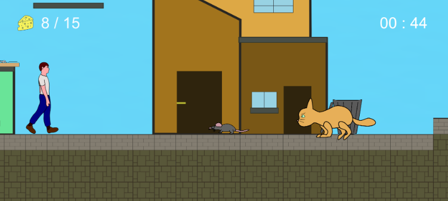
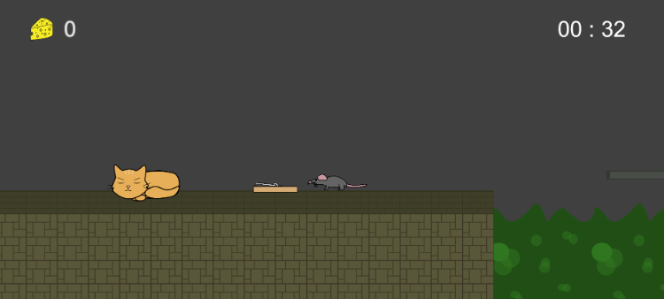

# Rato

Rato is a 2D Unity platformer about a rat trying to collect 15 pieces of cheese. Navigate the street and sewers, avoid cats, people and mousetraps, and see how quickly you can finish.

## Screenshots

*Street level with the cheese counter and timer.*

*A mousetrap and a sleeping cat along the route.*

## Play in Unity

1. Install Unity **2022.3.14f1** through Unity Hub.
2. Clone or download this repository, then add its folder as a project in Unity Hub.
3. Open `Assets/Scenes/Level1.unity` in the Unity Editor and press Play.

| Action | Keys |
| --- | --- |
| Move | A and D, or Left and Right arrows |
| Walk | Hold Left Shift while moving |
| Jump | Space |
| Search nearby trash | E |

## Credits

The original source credits Allan, Leandro, Nitsa, Samuca and Tanaka as contributors.

- Night ambience by klankbeeld on Freesound, used under [Creative Commons Attribution 4.0](https://creativecommons.org/licenses/by/4.0/). [Original recording](https://freesound.org/people/klankbeeld/sounds/766942/)
- This repository uses synthesized replacements for the original underwater ambience and cheese pickup sound.
